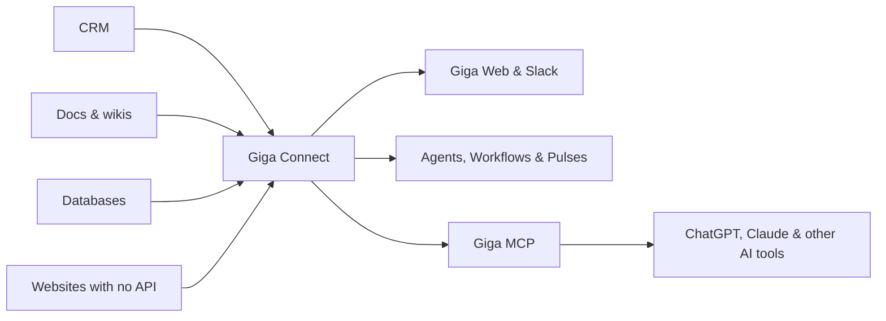

**Giga Connect** is how you connect your team's tools to Giga — your CRM, docs, analytics, databases, support desk, and the rest.

The key idea: **connect a tool once, then use it everywhere.** Once a tool is connected to Giga, you can use it from Giga Web and Slack, from your Agents, Workflows and Pulses — and from other AI tools like ChatGPT and Claude through [Giga MCP](/mcp/index), without connecting each app there separately.

[Learn how to use your connected tools from other AI tools →](/mcp/index)

## Where to find it in the app

- **Integrations** is where you connect tools: search the catalog and see what's **Connected**.
- **Cloud → Integrations** holds the keys, sign-ins and logins behind your integrations. [Learn about credentials in Cloud →](/connect/vault)

The profile menu's **Use Giga in…** is about the other direction: bringing Giga into Slack, Claude and ChatGPT. See [Giga MCP](/mcp/index).

## What you can connect

Apps from Giga's catalog, your own MCP servers, APIs, PostgreSQL databases, and even websites with no API at all through Giga's cloud browser. If a tool isn't in the catalog, Giga can add it just for your workspace.

[See how to connect your tools →](/connect/connecting)

## How Giga uses your integrations

When you or a teammate works with Giga, it only uses the integrations that person is allowed to use: their own, plus those shared with them.

- **Chats** can use any integration you have access to, and you can @-mention one to point Giga at it.
- **Tracks** can have integrations and databases linked to them.
- [**Agents**](/agents/index) and [**Workflows**](/workflows/index) use integrations as part of their work.
- [**Pulses**](/pulses/index) run as the person who owns them, using that person's integrations.

## Explore Giga Connect

<Columns cols="2">
  <Card title="Connecting your tools" href="/connect/connecting" icon="plug" horizontal="false">
    What you can connect, the ways to connect, and tools that aren't in the catalog.
  </Card>

  <Card title="Sharing and managing" href="/connect/sharing" icon="users" horizontal="false">
    Share integrations with your team and keep them healthy.
  </Card>

  <Card title="Credentials in Cloud" href="/connect/vault" icon="vault" horizontal="false">
    Where your keys, sign-ins and logins are kept, shared and audited.
  </Card>

  <Card title="Safety and security" href="/connect/security" icon="shield-check" horizontal="false">
    How Giga keeps your passwords, keys and tokens safe.
  </Card>
</Columns>
