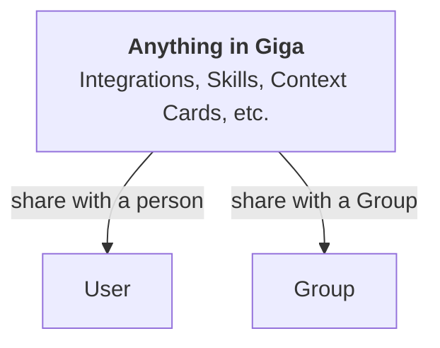

Giga is a unified company brain for high context teams.

- **High Context Team**: A team that manages a lot of streams and projects, and uses AI tools extensively to be more productive and get more done.
- **Unified Company Brain**: One place that keeps track of knowledge, information, decisions and activity, in real time.

## How It Works

- Giga sits "behind the scenes" of whatever AI tool you're using - you first install the relevant  Plugin (Giga works with any tool that supports MCP), for example the Giga ChatGPT plugin. 
- Once installed, your chat experience gains several new capabilities - you can now say "Giga Link" or "Giga Save" at any point to capture and save all your context. See [Key Phrases](/key-phrases) for more.&#x20;

## Core concepts&#x20;

### Users, Groups and sharing

Everything in Giga is built on one simple model for who can see and use what.

- **Users.** Everyone on your team has their own Giga account. What you create starts out private to you.
- **Groups.** A Group is a set of people, such as a team, a department, a project, or the whole company. You can add users to Groups in the web UI.
- **Sharing.** Almost anything in Giga can be shared with a whole Group or with one specific person.

The same model applies everywhere, in Giga Web, Slack, ChatGPT, and Claude, and Giga only ever draws on the things each person has been given access to.

### Tracks

A track is a shared space for an exploration, a project, or an ongoing area of work. It gives Giga somewhere to keep what it learns, and lets you share it with the right people instead of the whole team. 

It's the place where everything about that work comes together:

- **Chats** about the work, so conversations aren't scattered
- **Memory** of what's been decided, learned and done along the way
- **Context** such as background notes, links and reference material

When you work in a Track, Giga automatically brings in that Track's memory and context, and what you learn gets saved back to it. The next person to pick up the work starts from where things left off, not from scratch.

Tracks do a slightly different job depending on where you use Giga:

<Columns cols="2">
  <Card title="In the Giga web app" icon="monitor" horizontal="false">
    A Track is mainly a place to **organize** your chats and references for a piece of work.
  </Card>

  <Card title="In ChatGPT, Claude and other tools" icon="lock" horizontal="false">
    A Track is mainly a **memory container**. Memory saved to a Track is only ever available to the people added to that Track, so it never leaks to anyone else.
  </Card>

  <Card title="In Slack" icon="hash" horizontal="false">
    Link a Slack channel to a Track, and everything Giga learns in that channel stays in that Track. For example, **#acme-deal** goes to the _Acme renewal_ Track, so its memory and context never leak into other channels.
  </Card>
</Columns>

You share a Track with a Group (or add specific people), and only those people can see its chats, memory and context. One Group can have many Tracks. For example, the Sales Group might have a Track for each major deal.

##

