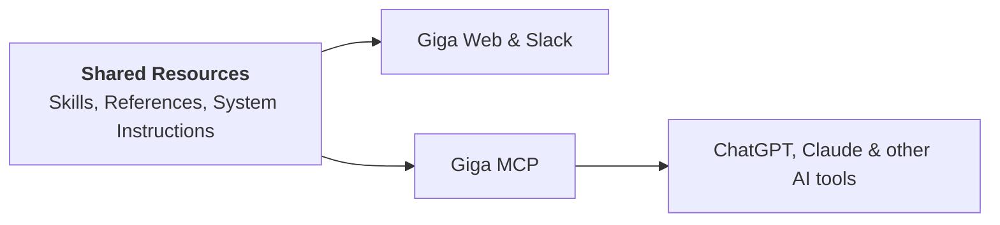

**Shared Resources** is where your team keeps the resources Giga uses to do great work: shared once, and available wherever your team works with Giga.

<Columns cols="2">
  <Card title="Skills" href="/skills/index" icon="sparkles" horizontal="false">
    Reusable instructions that teach Giga how to do a specific kind of work.
  </Card>

  <Card title="References" href="/library/bookmarks" icon="bookmark" horizontal="false">
    Links and notes saved to your Tracks, all in one list.
  </Card>

  <Card title="System Instructions" href="/library/context-cards" icon="id-card" horizontal="false">
    Standing instructions and background Giga can draw on in any conversation.
  </Card>
</Columns>

In the Giga web app, open **Cloud → Shared Resources** to browse every item you can access. Each item's page shows its details, **who can access it**, and the **Tracks** it's linked to. From there you can share it and link it to more Tracks, if you're allowed to.

Looking for structured data? [Data Stores](/library/datastores) are in **Cloud → Build & Automate**.

## Use your Shared Resources everywhere

Store an item in Shared Resources once, and your team can use it wherever they work with Giga: in Giga Web and Slack, and in other AI tools like ChatGPT and Claude through [Giga MCP](/mcp/index).

- **Use them:** ask for a skill or pull in System Instructions from any connected tool.
- **Edit them:** update items directly from ChatGPT, Claude or any MCP-connected tool. Changes are saved back to Giga, so everyone gets the latest version.
- **Open them (coming soon):** open an item, such as a skill, right inside ChatGPT or Claude to view and edit it there.

One set of Shared Resources, kept in one place, means your whole team works from the same instructions and context, whichever tool they prefer.

## Sharing items

Shared Resources follow the same [sharing model](/introduction#users-groups-and-sharing) as everything else in Giga. Items start out private to you, and you can share them with a Group or with specific people.

## Frequently asked questions

<ExpandableGroup>
  <Expandable title="Can my team use Shared Resources outside Giga?" default-open="false">
    Yes. Through Giga MCP, your team can use and edit Shared Resources from ChatGPT, Claude and other AI tools, without copying anything across.
  </Expandable>

  <Expandable title="If someone edits a skill in ChatGPT, does everyone see the change?" default-open="false">
    Yes. Edits made through Giga MCP are saved back to Giga, so everyone with access gets the updated version wherever they use it.
  </Expandable>

  <Expandable title="Who can see our Shared Resources?" default-open="false">
    Only the people they've been shared with. Items start out private to the person who created them, and can be shared with a Group or with specific people.
  </Expandable>

  <Expandable title="What's the difference between a Skill and System Instructions?" default-open="false">
    A Skill tells Giga **how** to do something, such as writing a sales proposal your way. System Instructions tell Giga **what** to know, such as your pricing or your brand guidelines.
  </Expandable>
</ExpandableGroup>
